


<a href="https://github.com/riokishanea?tab=repositories"></a>
<a href="https://www.linkedin.com/in/linkriokishanea"></a>
<a href="mailto:workflow.riokishan@gmail.com"></a>


<a href="https://github.com/riokishanea/mlh-app"></a>

<a href="https://github.com/riokishanea/movie-app-jsmastery"></a>

<a href="https://github.com/riokishanea/zulip"></a>

<a href="https://github.com/riokishanea/password-manager-cli"></a>

<a href="https://github.com/riokishanea/quiz-cli"></a>

<a href="https://github.com/riokishanea/skew-thenewsapp"></a>


